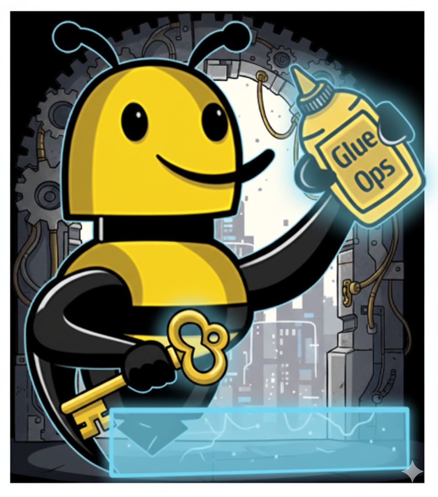

# GlueOps Core Gatekeeper


Gatekeeper is a small Kubernetes controller that answers one question per app:
**are this app's dependencies ready?**

You declare the dependencies in a `Gate` custom resource. Gatekeeper evaluates them
on a timer and publishes the answer to `Gate.status`. Argo CD reads that status as
resource health, so an ordinary sync wave holds your rollout until the dependencies
are actually up:

```yaml
# gate.yaml — applied in wave -1
apiVersion: platform.glueops.dev/v1alpha1
kind: Gate
metadata:
  name: my-app-dependencies
  annotations:
    argocd.argoproj.io/sync-wave: "-1"
spec:
  checks:
    - id: database
      deploymentAvailable:
        name: postgres
    - id: cache
      serviceReadyEndpoints:
        name: redis
```

Your workloads stay in the default wave and need no annotation. There is no hook
Job, no polling script, and no per-app RBAC.

This is useful when ordering has to span things sync waves can't see on their own —
Helm-managed components, Flux HelmReleases, other Argo CD Applications, and
dependencies that aren't represented as Kubernetes workloads at all.

---

## How it works

1. Gatekeeper lists every `Gate` in the cluster every 30 seconds.
2. For each check it reads the referenced resource and decides whether it's ready.
3. It writes a `Ready` condition plus a per-check breakdown to `Gate.status`.
4. Argo CD maps that condition to resource health via a Lua script, and a sync wave
   does the ordering.

Gatekeeper reads dependencies with its **own** ServiceAccount. What a Gate may
observe is bounded by two things: the kinds granted in gatekeeper's ClusterRole, and
the namespace rules below. Callers need no credentials and no RBAC of their own.

### The rule that decides what belongs in a Gate

**A Gate is re-evaluated on every sync, so the condition must stay true for the life
of the Application — not merely become true once.** It is a managed resource in wave
`-1` of every sync, not a one-shot precondition.

Gate on steady state ("the database is available", "the dependency is healthy"), not
on events. The classic mistake is gating on a migration Job: it works until
something removes the Job — `ttlSecondsAfterFinished`, a `HookSucceeded` hook
policy, Argo CD pruning, or someone deleting it to re-run the migration — and from
then on **every** sync of that Application hangs at wave `-1`.

### What this costs: readiness can be stale

Gatekeeper publishes readiness rather than answering requests on demand, so a
gatekeeper that is down or wedged leaves Gates showing their last known state.
Neither Argo CD's health rollup nor `kubectl wait` can tell how old that state is,
so a rollout gated on an already-`Ready` Gate can proceed on stale information.

This is a deliberate trade. The dependencies normally gated here are self-healing —
an app that starts before its database crashloops and then recovers — and it is how
Argo CD, Flux and cert-manager all already behave. `prometheusrule.yaml` ships the
alerts that cover it.

**Where it would genuinely hurt is a gate protecting something irreversible**, such
as a migration that an app must not start before. If you need that, say so — a
synchronous check that fails closed is a small addition, but it isn't in the box
today.

---

## Install

### 1. CRD and RBAC

```bash
kubectl apply -f crd.yaml
kubectl apply -f rbac.yaml
```

`rbac.yaml`'s ClusterRole is **the ceiling on what any Gate can observe**. A kind
granted there becomes readable by every Gate (in its own namespace, or an allowlisted
namespace in platform mode). Add kinds deliberately, and never grant `secrets` or
`configmaps`.

### 2. The controller

```bash
kubectl apply -f deploy.yaml
```

Set the image to a released tag pinned by digest and review the allowlist env vars
first. **It must be v2.0.0 or later** — v1.x is the request-API build, which serves
`/check` and never writes `Gate.status`, so Gates would sit with no condition and
every gated Application would hang at wave `-1`.

### 3. Teach Argo CD to read a Gate — required

Argo CD has no built-in health check for a `Gate`, so you give it one. This is the
whole script — it maps the `Ready` condition onto Argo CD's health vocabulary:

```lua
-- Reasons no amount of waiting can clear: each needs someone to change something
-- -- the Gate's spec, the namespace's mode label, gatekeeper's ClusterRole or
-- allowlist, or the stuck dependency itself. EvaluationFailed and
-- DependenciesNotReady are deliberately absent.
local stuck = {
  Terminal = true,
  PolicyViolation = true,
  ReadForbidden = true,
  InvalidSpec = true,
}
hs = {}
if obj.status == nil or obj.status.conditions == nil then
  hs.status = "Progressing"
  hs.message = "Awaiting first evaluation"
  return hs
end
for i, c in ipairs(obj.status.conditions) do
  if c.type == "Ready" then
    -- metav1 binds observedGeneration to the condition it was set from, so the
    -- condition's own field ties currency to the very condition about to be
    -- trusted; the status-level one is a fallback for writers that set only that.
    local observed = c.observedGeneration or obj.status.observedGeneration
    local generation = obj.metadata and obj.metadata.generation
    if generation == nil or observed ~= generation then
      hs.status = "Progressing"
      hs.message = "Awaiting evaluation of current spec"
      return hs
    end
    hs.message = (c.reason or "") .. ": " .. (c.message or "")
    if c.status == "True" then
      hs.status = "Healthy"
      return hs
    end
    -- Degraded fails the operation rather than waiting. It needs selfHeal: true
    -- to recover afterwards -- see AGENTS.md Decision 15, which records what this
    -- was measured to do.
    if stuck[c.reason] then
      hs.status = "Degraded"
      return hs
    end
    -- Everything else, including Unknown, means keep waiting. An unevaluable
    -- gate makes no claim about the dependency, so Degraded would be wrong.
    hs.status = "Progressing"
    return hs
  end
end
hs.status = "Progressing"
hs.message = "No Ready condition"
return hs
```

**If `argocd-cm` is managed by the argo-cd Helm chart** (the common case), put it in
your values under `configs.cm` and let your normal pipeline apply it:

```yaml
configs:
  cm:
    resource.customizations.health.platform.glueops.dev_Gate: |
      hs = {}
      ...          # the script above, indented under this key
```

**Otherwise patch the live ConfigMap** with the ready-made fragment:

```bash
kubectl patch configmap argocd-cm -n argocd --type merge \
  --patch-file examples/argocd-health-check.yaml
```

**Use `kubectl patch`, not `kubectl apply`.** Argo CD installs with client-side
apply, so applying a one-key `argocd-cm` manifest would three-way-merge and delete
every other key in it — after which Argo CD selfHeals the ConfigMap back, silently
removing this health check and un-gating every Gate in the cluster. The file is
shipped as a patch fragment so that mistake isn't possible. If `argocd-cm` is
managed by Helm or GitOps, add the key there instead (`configs.cm` in the argo-cd
chart).

**Without this step, Gates do nothing.** Argo CD has no built-in health check for a
`Gate`, and a resource with no health check is *skipped* in the Application health
rollup — the wave completes immediately and the next wave proceeds ungated.

**Also check `gates` isn't matched by `resource.exclusions`.** An excluded Gate is
stripped from the target objects before the sync, so it is never applied, never
produces a sync task, and wave 0 runs immediately — the same silent un-gating as a
missing health check. The only signal is an `ExcludedResourceWarning` condition on
the Application.

### 4. Set an Argo CD sync timeout — required

Set `--sync-timeout` (or `ARGOCD_APPLICATION_CONTROLLER_SYNC_TIMEOUT`) on the
application controller. It defaults to *never*, so a gate that legitimately never
becomes ready leaves the sync operation Running indefinitely — and a Running
operation blocks every later auto-sync of that Application, **including the commit
that would fix the gate**. Recovery then needs a manual
`argocd app terminate-op <app>`.

This is a controller-wide setting, so pick a value above the longest legitimate gate
wait in the cluster. **Start at `1800` (30 minutes)** and adjust: a Gate reports Ready
within one reconcile interval (30s by default) of its dependency coming up, so the
budget is almost entirely the dependency's own startup — a cold platform-stack
bootstrap is the long pole, not gatekeeper. Too low fails syncs that would have
succeeded; too high is the indefinite hang above, slower.

### 5. Use `selfHeal: true` — required for recovery

If your Applications use `syncPolicy.automated`, they need `selfHeal: true`:

```yaml
syncPolicy:
  automated:
    selfHeal: true
```

A *failed* sync operation blocks auto-sync of that revision exactly as hard as a
Running one — the controller logs `Skipping auto-sync: failed previous sync attempt
to [rev] and will not retry for [rev]`. So with `selfHeal: false`, once a gated sync
has failed, **fixing the dependency changes nothing**: the Gate flips back to `Ready`,
the Application stays `OutOfSync`, and the workload is never created until a new
commit lands. With `selfHeal: true` the controller re-initiates and recovers about
40 seconds after the Gate clears.

Two things that make the wedge hard to spot:

- `argocd app terminate-op` only releases an operation that is still *Running*. Once
  it has failed there is nothing to terminate; the way out is a manual sync (works at
  the same revision — measured) or a new commit.
- **The Application can read `Healthy` while wedged.** Once the dependency is fixed
  the Gate goes Ready, and if it's the only live resource the rollup follows it — so
  you see `health=Healthy`, `sync=OutOfSync`, and the gated workload simply absent.
  Alert on sync status, not health.

### 6. Monitoring — optional but strongly recommended

```bash
kubectl apply -f servicemonitor.yaml   # needs the Prometheus Operator
kubectl apply -f prometheusrule.yaml
```

Two labels decide whether this works at all, and getting either wrong fails
silently:

- The alerts key on `job="glueops-core-gatekeeper"`. The shipped ServiceMonitor
  produces exactly that. If you scrape some other way, fix the label in
  `prometheusrule.yaml` — otherwise `absent()` is true forever on a healthy cluster,
  the alert fires immediately and gets silenced.
- `metadata.labels` on both files must satisfy your Prometheus's `ruleSelector` /
  `serviceMonitorSelector`. kube-prometheus-stack defaults both to
  `{release: <releaseName>}`, so without that label they are accepted by the
  apiserver, appear in `kubectl get`, and are never loaded.

Verify rather than assume:

```bash
# in Prometheus
up{job="glueops-core-gatekeeper"}
prometheus_rule_group_last_evaluation_timestamp_seconds{rule_group=~".*gatekeeper.*"}
```

---

## Using it

Start from [`examples/wave-gating/`](examples/wave-gating) — an Application with a
Gate in wave `-1` and a Deployment in the default wave.

Four rules that are easy to get wrong:

- **Wave `-1`, not `0`.** The default wave *is* `0`, so a Gate at `0` shares a wave
  with un-annotated resources and orders nothing.
- **Same Application.** Sync waves only order resources within one sync, so a Gate
  cannot gate workloads in a different Argo CD Application. For that case, a PreSync
  Job running `kubectl wait --for=condition=Ready gate/x` works, but only if the
  Gate already exists — PreSync runs before manifests are applied, so a Gate shipped
  alongside the workloads won't exist yet and the wait will fail immediately.
- **Not a PreSync hook.** Hooks are not gated at all: they run ahead of the waves
  that contain the Gate, so a PreSync Job can be `Running` before the Gate even
  exists. A migration — the thing you would most want gated — must go in a wave
  after the Gate, not a hook.
- **A blocked Gate also blocks `prune`.** With `prune: true`, removing a resource
  from Git while the Gate is `False` pins the operation on the Gate's health and the
  prune never runs, so you can't withdraw a gated resource while its dependency is
  down.

### Confirming it actually gates

The failure mode to rule out is a Gate that exists but gates nothing — a missing
health check, a Gate in wave `0`, or a Gate in a different Application all look
fine until you check. Point an Application at a Gate whose dependency is *down* and
you should see the sync held:

```console
$ kubectl get application my-app -n argocd \
    -o jsonpath='{.status.operationState.phase}{"\n"}{.status.operationState.message}'
Running
waiting for healthy state of platform.glueops.dev/Gate/my-app-dependencies

$ kubectl get gates -n nonprod
NAME                  READY   REASON                 LAST-TRANSITION
my-app-dependencies   False   DependenciesNotReady   4m21s

$ kubectl get deploy my-app -n nonprod
Error from server (NotFound): deployments.apps "my-app" not found     # wave 0 held
```

The `waiting for healthy state of …/Gate/…` message is the proof: Argo CD is
blocking on the Gate specifically. Then make the dependency ready, and within one
reconcile interval:

```console
$ kubectl get gates -n nonprod
NAME                  READY   REASON   LAST-TRANSITION
my-app-dependencies   True    Ready    9s

$ kubectl get deploy my-app -n nonprod
NAME     READY   UP-TO-DATE   AVAILABLE   AGE
my-app   2/2     2            2           9s

$ kubectl get application my-app -n argocd \
    -o jsonpath='{.status.health.status} {.status.sync.status} {.status.operationState.phase}'
Healthy Synced Succeeded
```

If instead the workload appears immediately while the Gate is still `False`, the
Gate isn't gating. Check, in order: the health check from step 3 is installed, the
Gate is annotated `sync-wave: "-1"` and not `"0"`, the Gate is in the *same*
Application as the workload, and `gates` isn't matched by `resource.exclusions`.

### Reading status

```bash
$ kubectl get gates -A
NAMESPACE   NAME                  READY   REASON                 LAST-TRANSITION
nonprod     my-app-dependencies   False   DependenciesNotReady   40s

$ kubectl get gate my-app-dependencies -n nonprod -o jsonpath='{.status.results}' | jq .
[
  {"id":"database","ready":true,"reason":"Ready","message":"deployment Available=True"},
  {"id":"cache","ready":false,"reason":"DependenciesNotReady","message":"ready addresses 0 < 1"}
]
```

`REASON` separates the cases that need different responses:

| Reason | Status | Argo CD health | Meaning |
| --- | --- | --- | --- |
| `Ready` | True | Healthy | every check passed |
| `DependenciesNotReady` | False | Progressing | still waiting; expected to resolve on its own |
| `EvaluationFailed` | Unknown | Progressing | gatekeeper couldn't evaluate a check, so it makes no claim either way |
| `Terminal` | False | **Degraded** | the upstream controller has given up — a failed Job, a stalled HelmRelease |
| `PolicyViolation` | False | **Degraded** | the Gate references a namespace it isn't allowed to read |
| `ReadForbidden` | False | **Degraded** | gatekeeper's ClusterRole is missing a kind; the message names what to grant |
| `InvalidSpec` | False | **Degraded** | the Gate itself is malformed |

The four `Degraded` reasons are the ones that **cannot clear on their own** — each
needs someone to change something: the Gate's spec, the namespace's mode label,
gatekeeper's ClusterRole or allowlist, or the stuck dependency itself (deleting a
failed Job so it re-runs). The two `Progressing` ones are a gate doing its job and a
gate that couldn't answer, neither of which should fail a sync.

`Degraded` fails the sync operation, which is what makes the problem visible — the
Application reads `Degraded` and notifications fire, rather than looking like a slow
deploy until `--sync-timeout`. **It requires `selfHeal: true`** (step 5): a failed
operation blocks auto-sync of that revision, and a `Progressing` gate does *not* have
that problem, because a still-Running operation keeps re-checking the wave and simply
proceeds once the gate clears. That grace window is what `Degraded` trades away for
the clearer signal.

Because Argo CD folds resource health into the Application's on a worst-wins basis,
a waiting Gate shows up as the Application being `Progressing`, and any of the four
`Degraded` reasons above as `Degraded`. Annotating a Gate
`argocd.argoproj.io/ignore-healthcheck: "true"` removes it from that rollup while
leaving wave gating intact (the sync engine reads the Gate's health directly and
ignores the annotation).

The shipped example deliberately does **not** set it. Measured against the same
blocked Gate: without the annotation the Application reads `Progressing`, with it
the Application reads `Healthy` — i.e. healthy while its declared dependency is
down. Reach for it only if a `Degraded` Gate left in place keeping the Application
`Degraded` is worse for you than that. In practice the reason most likely to park an
Application there is `ReadForbidden` — a kind missing from gatekeeper's ClusterRole —
not a failed Job.

Note that `LAST-TRANSITION` is the last time the condition *changed*, not the last
time it was evaluated — so it cannot tell you whether gatekeeper is still running.
Use the sweep log or the metrics for that.

---

## The Gate resource

Each check sets **exactly one** check type. The CRD enforces that, which also
catches a misspelled type name — the API server prunes unknown fields, so without
the check a typo would leave a Gate that looks right in Git and verifies nothing.
(A typo *inside* a check block, like `minAvailableReplcias`, is pruned and silently
defaulted instead; only a client using strict field validation catches that, which
`kubectl` does by default.)

A check reads from the Gate's own namespace unless it sets `namespace:`, which
requires platform mode (below).

### `deploymentAvailable`

Deployment is `Available` with at least N available replicas.

```yaml
- id: api
  deploymentAvailable:
    name: my-api
    minAvailableReplicas: 2   # default 1
```

### `statefulSetReady`

StatefulSet has at least N ready replicas, optionally fully rolled out.

```yaml
- id: postgres
  statefulSetReady:
    name: postgres
    minReadyReplicas: 1            # default 1
    requireUpdatedRevision: true   # default true
```

### `jobComplete`

Job completed successfully. A `Failed` Job is reported as `Terminal`.

```yaml
- id: migrate
  jobComplete:
    name: my-app-migrate
```

> **Think twice before gating on this.** A Gate is re-evaluated on every sync, so
> once the Job is garbage-collected (`ttlSecondsAfterFinished`, a `HookSucceeded`
> hook, a prune) this check reports not-found forever and blocks every later sync.
> See [the rule above](#the-rule-that-decides-what-belongs-in-a-gate).

### `serviceReadyEndpoints`

Service has at least N ready backends, counted from its EndpointSlices.

```yaml
- id: redis
  serviceReadyEndpoints:
    name: redis
    minReadyAddresses: 1   # default 1
```

Counts ready endpoints, taking the maximum across address families — a dual-stack
Service has an IPv4 and an IPv6 slice describing the *same* pods, so they are not
added together.

### `podLabelReady`

At least N pods matching a label selector are `Ready`.

```yaml
- id: workers
  podLabelReady:
    selector: "app=my-worker,tier=backend"
    minReadyPods: 2   # default 1
```

> Prefer a specific selector — a broad one lists many pods on every sweep.

### `argoApplicationHealthy`

Argo CD Application is Healthy and/or Synced.

```yaml
- id: monitoring
  argoApplicationHealthy:
    name: monitoring-stack
    requireSynced: true    # default true
    requireHealthy: true   # default true
```

Nothing here is reported as `Terminal`. Argo CD health is a rollup over an
Application's resources rather than a statement that its controller stopped trying:
`Progressing` and `Degraded` both occur mid-rollout, and `Missing` is simply an
Application whose resources aren't live yet — which is exactly what a Gate guarding
a not-yet-bootstrapped stack should wait for.

### `fluxHelmReleaseReady`

Flux `helm.toolkit.fluxcd.io/v2` HelmRelease is Ready, on the current generation, and
not Stalled. A stalled release is reported as `Terminal`, because helm-controller has
explicitly stopped retrying until the spec changes.

```yaml
- id: cert-manager
  namespace: glueops-core-flux
  fluxHelmReleaseReady:
    name: cert-manager
    requireCurrentGeneration: true   # default true
```

Prefer this over pointing `deploymentAvailable` at the workload a HelmRelease manages.
A Deployment check reads whatever is in the cluster right now, so during a failed
upgrade it reports ready against the *previous* revision's pods while the release
behind them is broken.

Flux HelmReleases usually live in the namespace Flux reconciles from rather than
alongside the workload, hence the `namespace` override — which needs platform mode.

---

## Namespace modes

A Gate's namespace decides whether its checks may look outside that namespace. The
mode comes from a label on the namespace, which only the platform team can set:

```yaml
gatekeeper.platform.glueops.dev/mode: customer|platform
```

**`customer` (the default, including unlabelled namespaces)** — every check reads
from the Gate's own namespace. A `namespace:` override is refused with
`PolicyViolation`.

**`platform`** — checks may target another namespace, but only if it matches
`GATEKEEPER_PLATFORM_ALLOWED_NAMESPACES` or one of
`GATEKEEPER_PLATFORM_ALLOWED_NAMESPACE_PREFIXES`. Anything else is refused.

Both lists are **empty by default**, so a deployment that omits them gets no
cross-namespace access rather than a silently working allowlist.

Note that the allowlist is global: any platform-mode namespace can reach every
allowlisted namespace. "Who can create Gates in a platform-mode namespace" is
therefore a privileged grant.

---

## Configuration

| Env var | Default | Description |
| --- | --- | --- |
| `GATEKEEPER_RECONCILE_INTERVAL` | `30s` | How often to re-evaluate every Gate. Minimum 1s; anything lower or unparseable falls back to the default. To stop reconciling, scale the Deployment to 0. |
| `GATEKEEPER_PLATFORM_ALLOWED_NAMESPACES` | *(empty)* | CSV of namespaces platform-mode Gates may read from |
| `GATEKEEPER_PLATFORM_ALLOWED_NAMESPACE_PREFIXES` | *(empty)* | CSV of namespace prefixes, e.g. `glueops-core-` |
| `PORT` | `8080` | HTTP port for `/healthz` and `/metrics` |
| `GOMEMLIMIT` | *(unset)* | Standard Go setting; `deploy.yaml` sets it below the memory limit so growth costs GC rather than an OOMKill |

### Endpoints

- `GET /healthz` — plain process check, for the kubelet probe. It deliberately does
  **not** report sweep health: tying liveness to sweep success would turn an apiserver
  outage into CrashLoopBackOff, and a restarting pod reconciles less than a wedged one.
- `GET /metrics` — exports:
  - `gatekeeper_last_successful_sweep_timestamp_seconds` — last sweep that listed the
    Gates and wrote a status to every one of them.
  - `gatekeeper_gates_unevaluated` — Gates whose last evaluation reached no verdict.
  - `gatekeeper_sweep_duration_seconds` — wall time of the last sweep; distinguishes
    a slow sweep from a wedged one.

---

## Upgrading from an earlier build

The `Gate` schema changed incompatibly, which is what `v1alpha1` is for — the
version is unchanged, so `kubectl apply -f crd.yaml` works in place. There is no
`status.storedVersions` migration and nothing to convert: the apiserver prunes
removed fields such as `spec.strict` from Gates already in the cluster.

What does change for anyone who had Gates before:

- **`spec.strict` is gone.** Old manifests are rejected with an unknown-field error
  by any client using strict field validation, which includes `kubectl` by default
  and Argo CD's server-side apply. Delete the field.
- **Hook Jobs that called `/check` or `/explain` will fail**, because those
  endpoints no longer exist. Replace each one with the `sync-wave: "-1"` annotation
  on the Gate (see [Using it](#using-it)), and delete the Job along with its
  ServiceAccount, Role and RoleBinding.
- The two platform prerequisites in steps 3 and 4 above are new. Skipping either
  leaves Gates that silently gate nothing.

## Troubleshooting

**A Gate never leaves `DependenciesNotReady`.** Read `status.results` — it names the
check and why. Each message describes the actual resource state
(`availableReplicas 0 < 1`).

**A Gate says `ReadForbidden`.** Gatekeeper's ClusterRole is missing a kind the Gate
references. The message names it, e.g. `grant batch/jobs in its ClusterRole`.

**A Gate says `PolicyViolation`.** The check targets another namespace from a
`customer`-mode namespace, or from a platform-mode namespace to a target that isn't
allowlisted. The message names the target.

**A Gate says `EvaluationFailed`.** Gatekeeper couldn't complete a read — usually a
transient API error. The condition is `Unknown` rather than `False` on purpose: it is
not a claim that the dependency is unready.

**A sync hangs and the Gate looks healthy.** Check that the Lua health check from
step 3 is actually installed; without it Argo CD ignores the Gate entirely, the wave
task succeeds immediately, and the rollout proceeds ungated with *no* warning
anywhere — the Gate simply reports empty health and the Application reads Healthy.
This is the quietest way to break gating. A *syntax error* in the script is the
opposite: the operation goes `phase=Error` with a parse error and nothing is created.

**A sync is stuck Running and won't pick up new commits.** That's the
`--sync-timeout` default from step 4. Release it with
`argocd app terminate-op <app>`.

**The dependency is fixed, the Gate reads `Ready`, but the Application stays
`OutOfSync` and nothing deploys.** The previous sync *failed*, and a failed operation
blocks auto-sync of that revision — `Skipping auto-sync: failed previous sync attempt
… and will not retry`. `terminate-op` won't help, there is no operation to terminate.
Set `selfHeal: true` (step 5) so this recovers by itself; to unblock it now, run a
manual sync or push a commit.

**A migration ran before its gate.** PreSync hooks are not gated. Hooks run ahead of
the waves that contain the Gate, so at the moment a PreSync Job starts the Gate may
not even exist yet. Move the work into a wave after the Gate instead of a PreSync
hook.

**Is gatekeeper actually running?** Not answerable from `kubectl get gates` —
`LAST-TRANSITION` is deliberately inherited, so a Gate that has been Ready for days
looks identical whether it was evaluated seconds or hours ago. Use:

```bash
kubectl logs -n glueops-core-gatekeeper deploy/glueops-core-gatekeeper --tail=20 | grep sweep:
```

**`GatekeeperNotReconciling` is firing.** Gate readiness is stale, so gated rollouts
may have proceeded without their dependencies being verified. Check the Deployment,
confirm sweeps are completing with the command above, and once recovered review which
gated Applications synced during the window.

**`GatekeeperGatesUnevaluated` is firing.** Some Gates are stuck at `Ready=Unknown`,
so gated rollouts are *waiting* rather than proceeding. Find them with
`kubectl get gates -A | grep Unknown` and read `.status.results`.

---

## Local development

Everything runs in Docker; no Go toolchain needed on the host.

```bash
# build, vet and test
docker run --rm -v "$PWD":/w -w /w golang:1.26-alpine \
  sh -c 'go build ./... && go vet ./... && go test ./...'

# -race needs cgo, so use the Debian image
docker run --rm -v "$PWD":/w -w /w golang:1.26 go test -race ./...

# container image
docker build -t gatekeeper .
```

Two more suites live in `examples/argocd-health-check_test.lua` and
`prometheusrule_test.yaml`; CI runs all three, and each file's header has its commands.

To run it against a cluster, point `KUBECONFIG` at one and see `.env.example`.
End-to-end instructions, including a throwaway k3d cluster, are in
[AGENTS.md](AGENTS.md).
